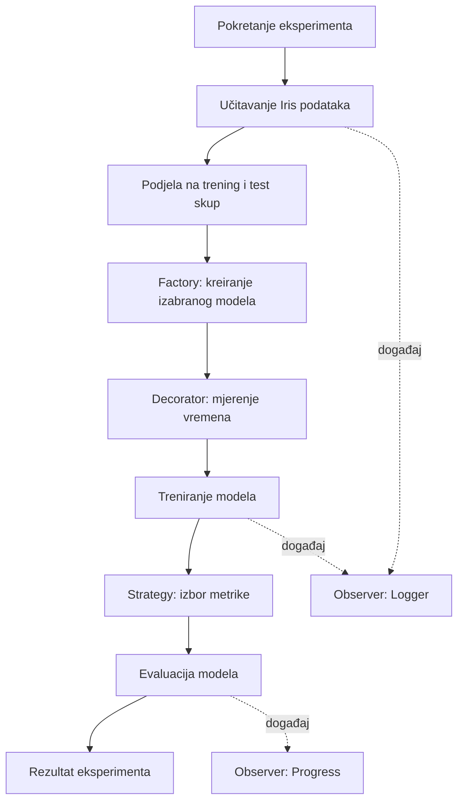
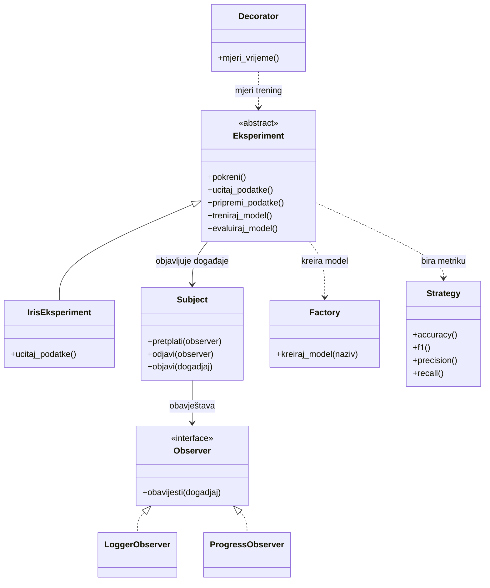

# Mini projekat 2: Mini okvir za ML eksperimente

**Predmet:** Napredno programiranje (FIST4NP)  
**Tema:** Projektni šabloni II – ponašanje i AI/ML  
**Skup podataka:** Iris (`scikit-learn`)

## 1. Cilj projekta

Cilj je implementirati mali i proširiv okvir za ML eksperimente koji demonstrira pet projektnih šablona iz prezentacije Nedjelja 4:

1. **Factory** – kreiranje ML modela na osnovu naziva.
2. **Strategy** – zamjena metrike bez izmjene evaluacionog toka.
3. **Observer** – obavještavanje pretplatnika o događajima eksperimenta.
4. **Template Method** – definisanje fiksnog redoslijeda koraka eksperimenta.
5. **Decorator** – mjerenje vremena izvršavanja bez izmjene osnovne funkcije.

Implementacija i demonstracija nalaze se u Google Colab notebook fajlu `Mini_projekat_2_ML_eksperimenti.ipynb`.

## 2. Korišćeni projektni šabloni

### 2.1 Factory – kreiranje modela

**Problem:** Kod koji koristi modele ne treba da sadrži više grana `if/elif` za kreiranje svakog konkretnog modela.

**Rješenje:** Registar `MODEL_FACTORY` povezuje naziv modela sa funkcijom koja kreira njegovu instancu. Funkcija `kreiraj_model(naziv)` vraća traženi model.

**Implementirani modeli:**
- Logistic Regression
- Decision Tree
- K-Nearest Neighbors (KNN)

**Posljedica:** Novi model se može dodati registracijom nove funkcije, bez izmjene koda koji pokreće eksperiment.

### 2.2 Strategy – zamjenjive metrike

**Problem:** Izbor metrike ne treba rješavati dugim lancem `if/elif`.

**Rješenje:** Svaka metrika je funkcija istog potpisa. Rječnik `METRIKE` čuva dostupne strategije, a `evaluiraj()` bira odgovarajuću funkciju prema nazivu.

**Implementirane metrike:**
- Accuracy
- F1 (weighted)
- Precision (weighted)
- Recall (weighted)

**Posljedica:** Metrike se mogu testirati i mijenjati nezavisno od ostatka eksperimenta.

### 2.3 Observer – praćenje događaja

**Problem:** Trening može imati više zainteresovanih komponenti, na primjer komponentu za logovanje i komponentu za prikaz statusa. Trening ne treba direktno da zavisi od njih.

**Rješenje:** `Subject` čuva listu pretplatnika i objavljuje događaje. `LoggerObserver` pamti događaje, a `ProgressObserver` prikazuje informaciju kada se eksperiment završi.

**Posljedica:** Novi posmatrač može se dodati pretplatom, bez izmjene klase eksperimenta.

### 2.4 Template Method – okvir eksperimenta

**Problem:** Različiti eksperimenti treba da prate isti redoslijed koraka, uz mogućnost prilagođavanja pojedinih koraka.

**Rješenje:** Bazna klasa `Eksperiment` definiše metod `pokreni()` i redoslijed:
1. učitavanje podataka;
2. priprema podataka;
3. treniranje modela;
4. evaluacija modela.

Klasa `IrisEksperiment` implementira učitavanje Iris skupa podataka.

**Posljedica:** Tok eksperimenta ostaje dosljedan, dok se konkretni detalji mogu mijenjati u izvedenim klasama.

### 2.5 Decorator – mjerenje vremena

**Problem:** Potrebno je izmjeriti trajanje treniranja bez dodavanja mjernog koda u samu logiku treniranja.

**Rješenje:** Dekorator `mjeri_vrijeme` mjeri trajanje funkcije i podatke čuva u listi `VREMENA_IZVRSAVANJA`. Primijenjen je na metodu `treniraj_model()`.

**Posljedica:** Mjerenje se dodaje nezavisno od osnovne implementacije metode.

## 3. Tok rada sistema

Notebook učitava Iris skup podataka, dijeli ga na trening i test dio, kreira izabrani model preko Factory registra, trenira ga i evaluira izabranom Strategy metrikom. Tok je definisan Template Method šablonom. Tokom rada `Subject` šalje događaje Observer komponentama, a Decorator mjeri vrijeme treniranja.

## 4. Arhitektura i odnosi između komponenti

## 5. Demonstracija na Iris skupu

Eksperiment se izvršava za tri modela:
- Logistic Regression
- Decision Tree
- K-Nearest Neighbors

Koristi se `train_test_split` sa `test_size=0.25`, `stratify` opcijom i fiksnim `random_state=42`, radi ponovljivosti. Podaci se standardizuju u pipeline-u za Logistic Regression i KNN. Stablo odlučivanja koristi model bez standardizacije.

Za svaki model se prikazuje izabrana glavna metrika (`accuracy`) i dodatne metrike (F1, precision i recall). Tačne vrijednosti se dobijaju pokretanjem notebook-a.

## 6. Testiranje

Notebook sadrži sedam testova:

| Test | Provjera |
|---|---|
| `test_factory_svi_modeli` | Svi registrovani modeli mogu da se kreiraju. |
| `test_factory_nepoznat_model` | Nepoznat naziv modela izaziva `ValueError`. |
| `test_strategy_accuracy` | Accuracy strategija vraća očekivanu vrijednost. |
| `test_strategy_nepoznata_metrika` | Nepoznata metrika izaziva `ValueError`. |
| `test_observer` | Observer prima i čuva objavljeni događaj. |
| `test_template_method` | Iris eksperiment izvršava cijeli tok i vraća rezultat. |
| `test_decorator_vrijeme` | Decorator evidentira vrijeme izvršavanja. |

Testovi se izvršavaju u notebook-u i ispisuju rezultat za svaki test.

## 7. Opis upotrebe AI alata

Tokom izrade projekta korišćen je **ChatGPT (OpenAI)** kao pomoćni AI alat za:
- razradu strukture mini okvira i raspoređivanje odgovornosti između pet projektnih šablona;
- pripremu Python implementacije Factory, Strategy, Observer, Template Method i Decorator šablona;
- predlaganje test slučajeva za provjeru osnovnih funkcionalnosti i očekivanih grešaka;
- izradu tehničke dokumentacije i Mermaid dijagrama u ovom README fajlu.

AI alat je korišćen kao pomoć pri pisanju i organizaciji rješenja, a ne kao zamjena za pokretanje i provjeru programa. Notebook je izvršen u cjelini, a testovi su pokrenuti radi provjere implementacije. Konačno rješenje treba pregledati i razumjeti prije predaje; rezultate i objašnjenja student treba da bude u stanju samostalno da obrazloži.

## 8. Zaključak

U projektu je implementiran mini okvir za ML eksperimente na Iris skupu podataka, uz primjenu pet projektnih šablona.

- **Factory** razdvaja kreiranje modela od ostatka aplikacije.
- **Strategy** omogućava izbor i zamjenu metrike preko zajedničkog interfejsa.
- **Observer** omogućava da više komponenti prati događaje eksperimenta bez direktne zavisnosti.
- **Template Method** obezbjeđuje jedinstven redoslijed koraka eksperimenta.
- **Decorator** dodaje mjerenje vremena bez izmjene osnovne logike treniranja.

Rješenje je proširivo: moguće je dodati novi model, metriku ili posmatrača bez većih izmjena postojećih komponenti. Sedam testova provjerava osnovne funkcionalnosti i očekivane greške.

## 9. Pokretanje u Google Colab-u

1. Otvoriti [Google Colab](https://colab.research.google.com/).
2. Izabrati **File → Upload notebook**.
3. Učitati `Mini_projekat_2_ML_eksperimenti.ipynb`.
4. Izabrati **Runtime → Run all**.
5. Ako nedostaje biblioteka, izvršiti `%pip install scikit-learn pandas`.

README i notebook treba čuvati zajedno u istom GitHub repozitorijumu.
